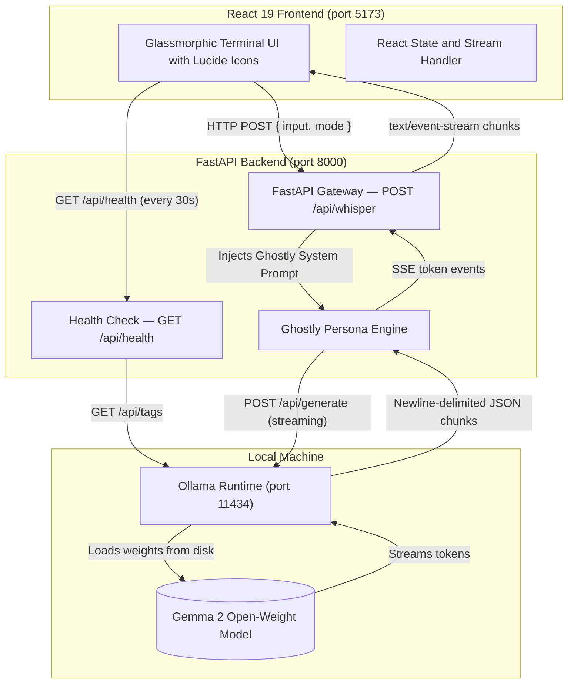
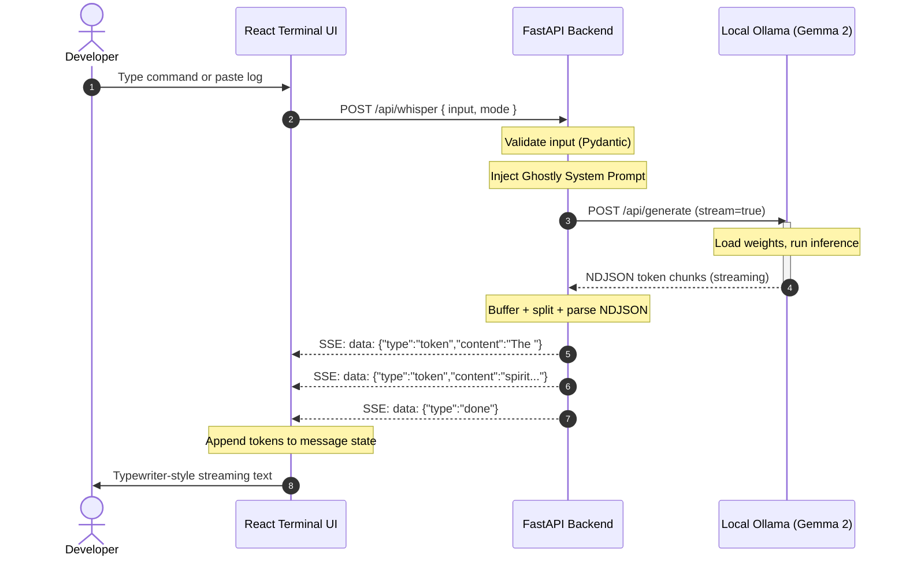

# ARCHITECTURE.md — GhostInTheShell Technical Architecture

> A complete technical reference for contributors and reviewers.

---

## 1. Project Goals and Architectural Principles

GhostInTheShell is designed around three non-negotiable principles:

| Principle | Implementation |
|---|---|
| **Privacy by default** | All inference runs on-device via Ollama; no external API calls are made |
| **Offline-first** | The application works without internet access once Ollama and the model are installed |
| **Transparency** | The system prompt, streaming protocol, and data flow are fully documented here |

Additional goals:

- Real-time streaming responses to minimise perceived latency on local hardware.
- Graceful degradation when Ollama is unavailable or the model is not installed.
- A polished UI that communicates status accurately without false positives.

---

## 2. High-Level System Architecture



---

## 3. Frontend Component Responsibilities

```
frontend/src/
├── App.jsx                 # Root component; owns all state and stream logic
├── main.jsx                # React 19 entry point
├── index.css               # Global styles, aurora background, glass panels
└── components/
    ├── TerminalHeader.jsx  # App branding + connection status bar
    ├── ConnectionStatus.jsx# Ollama status indicator (dot + icon + model badge)
    ├── TerminalInput.jsx   # Textarea, mode selector, submit button
    ├── MessageBubble.jsx   # Individual conversation message (user or ghost)
    └── CommandHistory.jsx  # Collapsible sidebar with previous inputs
```

### State managed in `App.jsx`

| State variable | Type | Purpose |
|---|---|---|
| `connectionStatus` | `"checking" \| "connected" \| "disconnected" \| "error"` | Ollama health |
| `model` | `string` | Model name from health endpoint |
| `messages` | `Message[]` | Full conversation history |
| `commandHistory` | `HistoryEntry[]` | User inputs for history sidebar |
| `inputValue` | `string` | Current textarea value |
| `mode` | `"command" \| "log" \| "whisper"` | Selected interaction mode |
| `isStreaming` | `boolean` | Whether a generation is in progress |
| `showHistory` | `boolean` | History sidebar visibility |

---

## 4. Backend API Responsibilities

```
backend/
├── main.py           # Entire FastAPI application
└── requirements.txt  # Python dependencies
```

### Responsibilities of `main.py`

- **CORS middleware** — allows requests from configured origins (default: localhost:5173).
- **Input validation** — Pydantic model enforces non-empty input, max length, and valid mode.
- **Prompt construction** — mode-specific prefix + the ghostly system persona.
- **Ollama client** — async httpx streaming connection to `http://localhost:11434/api/generate`.
- **SSE serialisation** — converts Ollama''s NDJSON tokens into `data: {...}\n\n` SSE events.
- **Error handling** — catches connection errors, timeouts, model errors, and client disconnects.
- **Health endpoint** — `/api/health` probes Ollama and returns connection state.

---

## 5. Ghostly Persona and Prompt Engineering

### System prompt design philosophy

The system prompt must balance two competing goals:

1. **Atmosphere** — the ghost must feel mysterious, ancient, and poetic.
2. **Accuracy** — technical explanations must be correct and actionable.

The prompt achieves this through explicit rules that constrain the model''s behaviour:

- "Never claim to have executed a command or accessed real-time data."
- "Distinguish clearly between what you know as fact and what is speculation."
- "150–300 words — concise enough for a terminal interface."
- "Structure: atmospheric observation → technical analysis → closing insight."

### Mode-specific prompt prefixes

Each interaction mode uses a different framing to prime the appropriate style:

| Mode | Framing |
|---|---|
| `command` | "The developer has submitted this shell command for your spectral analysis…" |
| `log` | "The developer has offered you this system log from the depths of their machine…" |
| `whisper` | "The developer whispers into the void… Respond as the ghost you are." |

### Ollama generation parameters

| Parameter | Value | Rationale |
|---|---|---|
| `temperature` | `0.85` | High enough for creative prose, low enough for technical coherence |
| `top_p` | `0.92` | Nucleus sampling to avoid degenerate repetition |
| `num_predict` | `512` | Caps response length for terminal readability |

---

## 6. Ollama and Gemma Integration

### Ollama API used

| Endpoint | Method | Purpose |
|---|---|---|
| `/api/generate` | POST | Generate and stream a model response |
| `/api/tags` | GET | List installed models (used for health check) |

### Request to `/api/generate`

```json
{
  "model": "gemma2:2b",
  "prompt": "<mode-specific prefix + user input>",
  "system": "<ghostly system prompt>",
  "stream": true,
  "options": {
    "temperature": 0.85,
    "top_p": 0.92,
    "num_predict": 512
  }
}
```

### Ollama streaming response format

Ollama returns a sequence of newline-delimited JSON objects:

```json
{"model":"gemma2:2b","created_at":"...","response":"The ","done":false}
{"model":"gemma2:2b","created_at":"...","response":"ancient ","done":false}
{"model":"gemma2:2b","created_at":"...","response":"spirit ","done":false}
{"model":"gemma2:2b","created_at":"...","response":"stirs.","done":true,"total_duration":1234567,"...":"..."}
```

**Important:** Network chunk boundaries do not align with JSON line boundaries. A single `aiter_bytes()` yield may contain multiple lines, a partial line, or both. The backend buffer-and-split strategy handles this correctly.

---

## 7. Request and Response Schemas

### `POST /api/whisper` — Request

```typescript
interface WhisperRequest {
  input: string;  // 1–8000 characters; trimmed
  mode: "command" | "log" | "whisper";  // defaults to "command"
}
```

### `POST /api/whisper` — Response (SSE stream)

`Content-Type: text/event-stream`

Each event is a line of the form:

```
data: <json>\n\n
```

Three event types:

```typescript
// A generated token
{ type: "token"; content: string }

// Generation complete
{ type: "done" }

// An error occurred
{ type: "error"; message: string }
```

### `GET /api/health` — Response

```typescript
interface HealthResponse {
  service: string;
  version: string;
  ollama_connected: boolean;
  ollama_url: string;
  model: string;
}
```

---

## 8. Streaming Protocol and Lifecycle

### Backend streaming pipeline

```
Client POST /api/whisper
  │
  ▼
Input validation (Pydantic)
  │
  ▼
build_prompt() — construct mode prefix + user input
  │
  ▼
stream_ollama_response(prompt)
  │  ├─ Open async httpx stream to Ollama /api/generate
  │  ├─ Accumulate bytes in rolling buffer
  │  ├─ Split buffer on "\n", keep tail
  │  ├─ JSON-parse each complete line
  │  └─ yield SSE token / done / error events
  │
  ▼
FastAPI StreamingResponse (media_type="text/event-stream")
  │
  ▼
Browser receives chunks
```

### Frontend stream reading pipeline

```
fetch POST /api/whisper
  │
  ▼
response.body.getReader()
  │
  ▼
Loop: reader.read()
  │  ├─ decode bytes to string (TextDecoder with stream:true)
  │  ├─ append to sseBuffer
  │  ├─ split on "\n", keep last fragment
  │  ├─ filter lines starting with "data:"
  │  ├─ JSON.parse each payload
  │  └─ dispatch: token → append to message | done → mark complete | error → set error state
  │
  ▼
React state update → re-render → typewriter effect visible to user
```

---

## 9. Runtime Execution and Streaming Sequence



---

## 10. Error Handling and Recovery

### Backend error scenarios

| Scenario | Detection | SSE event emitted |
|---|---|---|
| Ollama not running | `httpx.ConnectError` | `{"type":"error","message":"..."}` |
| Model not installed | Ollama returns 404 or error JSON | `{"type":"error","message":"..."}` |
| Inference timeout | `httpx.ReadTimeout` | `{"type":"error","message":"..."}` |
| Malformed NDJSON | `json.JSONDecodeError` | Line skipped; logged |
| Client disconnect | `raw_request.is_disconnected()` | Stream aborted silently |
| Empty/oversized input | Pydantic validation | HTTP 422 Unprocessable Entity |

### Frontend error scenarios

| Scenario | Detection | UI behaviour |
|---|---|---|
| Backend unreachable | `fetch` throws `TypeError` | Error message bubble |
| SSE `error` event | `event.type === "error"` | Error bubble with message |
| Stream ends without `done` | Loop exits normally | Message marked complete |
| User submits while streaming | `isDisabled` guard | Submit button disabled |
| AbortController cancel | `err.name === "AbortError"` | Silently ignored |

---

## 11. Privacy and Security Considerations

### Data flow boundary

All data stays within the local machine:

```
Browser (localhost:5173) → FastAPI (localhost:8000) → Ollama (localhost:11434) → Model weights (disk)
```

No network egress beyond the loopback interface is required or performed during inference.

### CORS configuration

The backend accepts requests only from explicitly listed origins (default: `http://localhost:5173`). In production deployments behind a reverse proxy, CORS origins should be restricted further.

### Input handling

- Input is validated and size-limited before reaching Ollama.
- Submitted text is used **only** as prompt content — it is never interpreted as OS commands.
- The system prompt instructs the model to handle sensitive log content (passwords, tokens) obliquely and to warn the developer rather than repeating it.

### What the application does NOT do

- Does not persist conversation data to disk.
- Does not send telemetry or analytics to any external service.
- Does not execute submitted shell commands.
- Does not require authentication or API keys for operation.

---

## 12. Local Development and Configuration

### Starting all services

```bash
# Terminal 1: Ollama daemon
ollama serve

# Terminal 2: FastAPI backend
cd backend && uvicorn main:app --reload --port 8000

# Terminal 3: Vite dev server
cd frontend && npm run dev
```

### Port summary

| Service | Default port | Configurable via |
|---|---|---|
| Vite dev server | 5173 | `vite.config.js` |
| FastAPI backend | 8000 | `uvicorn` CLI arg |
| Ollama daemon | 11434 | `OLLAMA_BASE_URL` env var |

### Switching to Gemma 2 7B

```bash
ollama pull gemma2:7b
```

Then set `OLLAMA_MODEL=gemma2:7b` in `backend/.env` and restart the backend.

---

*Last updated: October 2026 · Hacktoberfest 2026 — Week 4*
